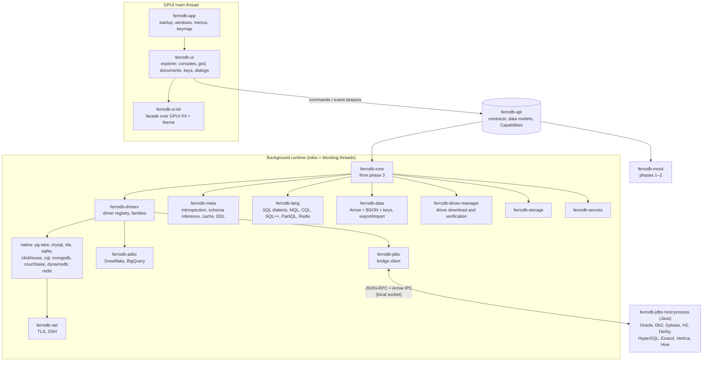
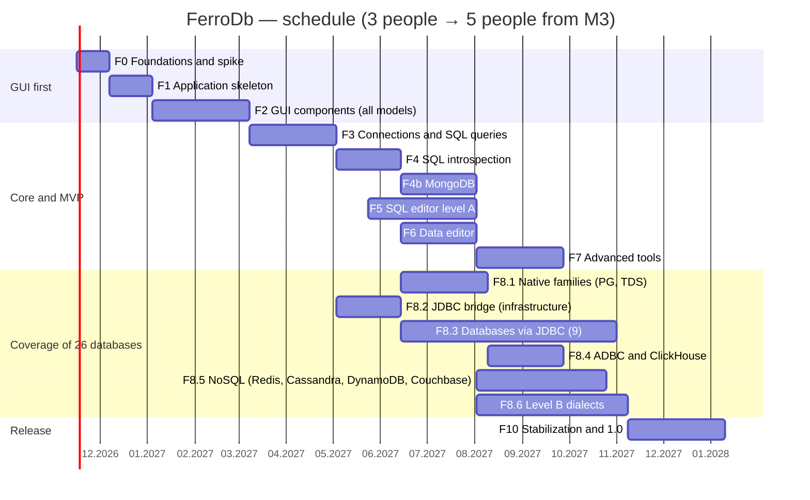

# FerroDb — Plan for Building a Cross-Platform Database IDE (SQL and NoSQL) in Rust

## Table of Contents

1. [Goal and assumptions](#1-goal-and-assumptions)
2. [Functional scope](#2-functional-scope)
3. [Non-functional requirements](#3-non-functional-requirements)
4. [Technology stack](#4-technology-stack)
5. [Architecture](#5-architecture)
6. [“GUI first” strategy](#6-gui-first-strategy)
7. [Implementation phases](#7-implementation-phases)
8. [Schedule, team and milestones](#8-schedule-team-and-milestones)
9. [Quality and testing](#9-quality-and-testing)
10. [Risks and mitigations](#10-risks-and-mitigations)
11. [MVP, 1.0 scope and further iterations](#11-mvp-10-scope-and-further-iterations)
12. [First steps (first 2 weeks)](#12-first-steps-first-2-weeks)
13. [Appendices](#13-appendices)

---

## 1. Goal and assumptions

**Goal:** a native, fast IDE for working with many databases — relational, analytical and NoSQL — running on Windows, macOS and Linux from a single Rust codebase.

**Key assumptions:**

1. **GUI first.** Phases 0–2 deliver a complete, “clickable” application running on test (mock) data for all data models. Logic is added in later phases under the finished interface.
2. **Multi-model from day one.** Contracts, the metadata model and the result model support three kinds of data from the start: **tabular** (SQL, CQL), **document** (MongoDB, Couchbase, DynamoDB) and **key-value** (Redis).
3. **Capabilities instead of lowest common denominator.** Each driver declares its features (`Capabilities`): query language, transactions, strict or inferred schema, execution plans, joins, etc. The GUI shows features based on capabilities.
4. **Broad database coverage through families and access layers.** 26 databases in 1.0 is a realistic goal only with code reuse:
   - **protocol families** — e.g. one PostgreSQL protocol driver supports PostgreSQL, Greenplum, CockroachDB and Redshift;
   - **three access layers** — native Rust (best performance), ADBC (cloud databases returning data directly in Arrow format), JDBC bridge (databases without a good Rust driver).
5. **The definition of a “supported database”** is the same for all 26 (section 2.9), and every driver passes the same compatibility test suite (`ferrodb-driver-tck`).
6. **Contract instead of coupling.** The GUI talks to the logic exclusively through interfaces from the `ferrodb-api` crate. `MockBackend` implements them first, then the real core — without rewriting the views.
7. **Core independent of the GUI.** Logic crates do not depend on the GUI library, so they are testable without a window, and changing the GUI framework does not touch the logic.
8. **Performance is a requirement, not an optimization.** The UI thread never performs I/O; results stream in and are virtualized.
9. **Safe by default.** Environment colors, read-only mode, warnings for dangerous operations, passwords in the system secret store, drivers downloaded only from trusted sources with checksum verification.

**Team:** 3 people until milestone M3, then 5 people (details in section 8). With a constant team of 3, version 1.0 shifts by about 5–6 months.

---

## 2. Functional scope

Priorities: **MVP** (first usable version), **1.0** (first full release), **Later** (1.x releases and beyond).

### 2.1 Database management

| Feature | Priority | Phase |
|---|---|---|
| Multiple data sources (SQL and NoSQL) in one window, shared object tree | MVP | 2 → 4 / 4b |
| Pattern filters, grouping into folders, environment colors (e.g. production = red) | MVP | 2 → 4 |
| Data source templates, copy/paste of configurations, sharing between projects | 1.0 | 3 |
| SSH, SSL/TLS, read-only mode | MVP | 3 / 4b |
| Cloud authentication: AWS (IAM, profiles, SSO), Azure (Microsoft Entra ID), Google (service account, ADC), Snowflake (password, key pair, SSO) | 1.0 | 8 |
| Driver manager: on-demand download of JDBC/ADBC drivers and Java runtime, versions, custom JDBC drivers | 1.0 | 2 → 8 |
| “Search Everywhere” — tables, collections, keys, files, actions, text | MVP | 1 → 4 |
| ER diagrams (relational databases) | 1.0 | 2 → 7 |
| Cloud database discovery (AWS / GCP / Azure / MongoDB Atlas) | Later | — |

### 2.2 Working with SQL

| Feature | Priority | Phase |
|---|---|---|
| Syntax highlighting, folding, multiple cursors, find/replace — all dialects | MVP / 1.0 | 2 / 8 |
| Schema-aware completion: full `JOIN` based on foreign keys, columns in `INSERT`, name shortcuts | MVP | 5 |
| Real-time error detection, inspections, quick fixes (level A dialects) | 1.0 | 5 |
| Live templates (built-in and custom) | 1.0 | 5 |
| “Rename” refactoring (level A dialects) | 1.0 | 5 |
| Code formatting | MVP | 5 |
| DDL generation (single and bulk), object snippets, procedure call scripts | MVP / 1.0 | 4 / 8 |
| Visual table editor with generated DDL preview | 1.0 | 2 → 7 |

Dialect support levels are described in section 2.10.

### 2.3 Working with document databases (MongoDB, Couchbase, DynamoDB)

| Feature | Priority | Phase |
|---|---|---|
| MongoDB: `mongodb://` and `mongodb+srv://` URIs, replica sets, sharding, TLS, SCRAM and X.509, read preference | MVP | 2 → 4b |
| Tree: MongoDB (databases → collections → indexes), Couchbase (buckets → scopes → collections → indexes), DynamoDB (tables → GSI/LSI indexes) | MVP / 1.0 | 4b / 8 |
| Inferred schema (document sampling; in Couchbase also `INFER`) | MVP / 1.0 | 4b / 8 |
| MongoDB console in shell syntax: `db.coll.find(...)`, `aggregate([...])`, write operations | MVP | 2 → 4b |
| Couchbase console in SQL++ and DynamoDB in PartiQL | 1.0 | 8 |
| Suggestions: collections, methods, operators, field names from inferred schema | MVP / 1.0 | 4b / 8 |
| Results as tree, JSON and table (flattened fields) | MVP | 2 → 4b |
| Editing documents/items with operation preview | MVP / 1.0 | 4b / 8 |
| Warnings: `deleteMany({})`, `updateMany({})`, `drop`, `DELETE` without `WHERE` in SQL++/PartiQL | MVP / 1.0 | 4b / 8 |
| Index management | 1.0 | 4b / 8 |
| Execution plan (`explain`) for MongoDB and Couchbase | 1.0 | 7 / 8 |
| Visual aggregation pipeline builder, full JavaScript scripts like in `mongosh` | Later | — |

### 2.4 Working with key-value and wide-column databases (Redis, Cassandra)

| Feature | Priority | Phase |
|---|---|---|
| Redis: key browsing by pattern (`SCAN`), tree by separator (e.g. `:`), views per type (string, hash, list, set, zset, stream), TTL, command console with suggestions | 1.0 | 2 → 8 |
| Cassandra: keyspaces → tables → columns (partition key, clustering keys), materialized views, indexes; CQL console; paging via `paging state` | 1.0 | 8 |
| Cassandra: warnings for queries without a partition key (`ALLOW FILTERING`) | 1.0 | 8 |

### 2.5 Running queries

| Feature | Priority | Phase |
|---|---|---|
| Multiple consoles, switching database/schema on the fly | MVP | 2 → 3 |
| Execution modes: smallest / largest statement under cursor, selection, whole script; parameters | MVP | 3 |
| Naming result tabs with a comment before the query | 1.0 | 3 |
| Auto/Manual transactions (where the database supports them), warnings for dangerous operations | MVP | 3 / 4b |
| Execution plan as table and diagram | 1.0 | 7 / 8 |
| Query cost estimate before execution for pay-per-data databases (BigQuery: dry run) | 1.0 | 8 |
| Query history, Local History for consoles and files, full query log | MVP / 1.0 | 3 / 7 |
| Notebook-style console (results below the query) | Later | — |

### 2.6 Working with data

| Feature | Priority | Phase |
|---|---|---|
| “Excel-like” grid: sorting, filtering, searching (including regex), selection aggregates | MVP | 2 → 6 |
| Cell editing, pasting, bulk changes, change preview, commit/rollback | MVP | 6 |
| Foreign key navigation (“related rows”) | 1.0 | 6 |
| Comparing two results (diff with tolerance and column exclusion) | 1.0 | 6 |
| Export: CSV, JSON, HTML, Markdown, XLSX, SQL, Parquet; import CSV/XLSX/JSON | MVP / 1.0 | 6 |
| Copying data between databases — including between models (table → collection and back) | 1.0 | 6 |
| Charts (bar, line, pie) from results | 1.0 | 6 |
| Spatial data map | Later | — |

### 2.7 Files, AI, extensibility

| Feature | Priority | Phase |
|---|---|---|
| Project file panel; SQL, CQL, JS, CSV, JSON files side by side | 1.0 | 7 |
| SQL queries directly on CSV / Parquet / JSON files (embedded DuckDB) | 1.0 | 7 |
| AI assistant, permission layer for agents, MCP server | Later (1.1, optional) | 9 |
| Custom export formats and aggregates (scripts) | Later (1.1) | 9 |
| Git integration (basic) | Later | — |

AI was moved after version 1.0 to free resources for covering 26 databases.

### 2.8 Databases supported in version 1.0 (minimum 26)

Access layers: **N** — native driver in Rust, **A** — ADBC (dynamically loaded library, results in Arrow), **J** — JDBC bridge (separate Java process, section 5.9).

| # | Database | Model | Language | Family / protocol | Layer | Driver | Language intelligence level |
|---|---|---|---|---|---|---|---|
| 1 | PostgreSQL | tabular | SQL (PostgreSQL) | PostgreSQL wire | N | `tokio-postgres` | A |
| 2 | Greenplum | tabular | SQL (PostgreSQL + extensions) | PostgreSQL wire | N | `tokio-postgres` | B |
| 3 | CockroachDB | tabular | SQL (PostgreSQL + extensions) | PostgreSQL wire | N | `tokio-postgres` | B |
| 4 | Amazon Redshift | tabular | SQL (Redshift) | PostgreSQL wire | N | `tokio-postgres` + IAM authentication (`aws-config`) | B |
| 5 | MySQL | tabular | SQL (MySQL) | MySQL protocol | N | `mysql_async` | A |
| 6 | MariaDB | tabular | SQL (MariaDB) | MySQL protocol | N | `mysql_async` | A |
| 7 | SQLite | tabular | SQL (SQLite) | embedded library | N | `rusqlite` | A |
| 8 | Microsoft SQL Server | tabular | T-SQL | TDS | N | `tiberius` | A |
| 9 | Azure SQL Server | tabular | T-SQL | TDS | N | `tiberius` + Microsoft Entra ID (`azure_identity`) | A |
| 10 | Oracle | tabular | SQL + PL/SQL | Oracle Net | J | Oracle JDBC (thin — no Instant Client) | A |
| 11 | IBM Db2 | tabular | SQL (Db2) | DRDA | J | IBM JDBC (JCC) | B |
| 12 | Sybase ASE | tabular | T-SQL (Sybase) | TDS 5.0 | J | jConnect / jTDS | B |
| 13 | H2 | tabular | SQL (H2) | H2 (file / TCP) | J | H2 JDBC | B |
| 14 | Apache Derby | tabular | SQL (Derby) | embedded / DRDA | J | Derby JDBC | B |
| 15 | HyperSQL | tabular | SQL (HSQLDB) | embedded / HSQL | J | HSQLDB JDBC | B |
| 16 | Exasol | tabular | SQL (Exasol) | WebSocket API | J | Exasol JDBC | B |
| 17 | Vertica | tabular | SQL (Vertica) | Vertica protocol | J | Vertica JDBC | B |
| 18 | Apache Hive | tabular | HiveQL | HiveServer2 (Thrift) | J | Hive JDBC | B |
| 19 | Snowflake | tabular | SQL (Snowflake) | Snowflake API | A | ADBC Snowflake driver | B |
| 20 | Google BigQuery | tabular | GoogleSQL | BigQuery API | A | ADBC BigQuery driver | B |
| 21 | ClickHouse | tabular | SQL (ClickHouse) | HTTP | N | `clickhouse` | B |
| 22 | Apache Cassandra | tabular (wide-column) | CQL | CQL native protocol | N | `scylla` (Cassandra-compatible) | B |
| 23 | MongoDB | document | MQL (shell syntax) | MongoDB wire | N | `mongodb` | A (MQL) |
| 24 | Couchbase | document | SQL++ | Couchbase | N | `couchbase` (official Rust SDK) | B |
| 25 | Amazon DynamoDB | document (key-value) | PartiQL + API operations | AWS API | N | `aws-sdk-dynamodb` | B |
| 26 | Redis | key-value | Redis commands | RESP | N | `redis` | B (commands) |

**Layer summary:** 15 databases natively (including 4 through one PostgreSQL protocol driver, 2 through the MySQL protocol, 2 through TDS), 2 through ADBC, 9 through the JDBC bridge.

Notes:
- JDBC and ADBC drivers **are not bundled with the installer**. The driver manager downloads them on demand from trusted sources (e.g. Maven Central) with checksum verification and displays the driver license. This keeps the installer small and respects vendors' licenses.
- For Oracle, JDBC thin was chosen because it does not require installing Oracle Instant Client. A native driver (`oracle`) can be added later as an option.
- The embedded **DuckDB** (file query engine) is an additional, 27th database — natively.
- The JDBC bridge also allows connecting **any custom JDBC driver** (as in DataGrip) — with level C support.

### 2.9 Definition of a “supported database” in 1.0

Each of the 26 databases must meet all of the points below (verified by `ferrodb-driver-tck`):

1. Connection with the database's typical authentication methods, TLS, SSH tunnel (where applicable) and connection test.
2. Database Explorer with introspection of objects specific to the database (schemas, tables, views, collections, indexes, keys, procedures — depending on the database) and filtering.
3. Console with highlighting, statement splitting and schema-aware suggestions.
4. Query execution with streamed results, paging and cancellation.
5. Result display in the view appropriate for the model (grid / documents / keys) with faithful type mapping.
6. Data editing where the database allows it (identifiable row/document/key), with operation preview.
7. Object definition (server-side or generated DDL) to the console or clipboard.
8. Auto/Manual transactions where the database supports them; clear information in the UI when it does not.
9. Read-only mode and warnings for dangerous operations.
10. Result export (at least CSV, JSON, XLSX).
11. Integration tests in CI (container, emulator or nightly tests on a cloud account — Appendix D).

Advanced features — refactoring, full inspections, execution plans as diagrams, schema comparison, ER diagrams — are guaranteed in 1.0 for databases with level A language intelligence, and available wherever the database provides the necessary information for the others.

### 2.10 Query language support levels

| Level | Scope | Languages in 1.0 |
|---|---|---|
| **A — full** | highlighting, statement splitting, schema-aware suggestions (including `JOIN` on foreign keys), name resolution, inspections and quick fixes, formatter, “Rename” refactoring, DDL generation | PostgreSQL, MySQL/MariaDB, SQLite, T-SQL (SQL Server, Azure SQL), Oracle SQL + PL/SQL, MQL (MongoDB) |
| **B — standard** | highlighting, statement splitting, schema-aware suggestions (objects, columns/fields, keywords, built-in functions), syntax diagnostics, formatter | remaining SQL dialects from table 2.8, CQL, SQL++, PartiQL, Redis commands |
| **C — basic** | generic SQL highlighting, statement splitting, object name suggestions from JDBC metadata | custom JDBC drivers |

Level B dialects are promoted to level A in subsequent 1.x releases, in the order driven by user popularity.

---

## 3. Non-functional requirements

| Area | Target / budget |
|---|---|
| Platforms | Windows 10/11 x64 (later ARM64), macOS (Apple Silicon and Intel; minimum version to be set according to GPUI), Linux x64 — X11 and Wayland |
| App startup | window < 1 s (warm start), < 2 s (cold start) |
| First connection via JDBC bridge | < 2 s to readiness (starting the Java process), subsequent connections without this overhead |
| Smoothness | 60 fps (120 fps on high-refresh displays) when scrolling a result of 1 million rows × 50 columns |
| Documents and keys | smooth scrolling of 100k documents and 1M Redis keys; 5 MB document without blocking the UI |
| Editor | key response < 16 ms for a 50k-line file |
| Completion | < 50 ms with 10k objects in the metadata cache |
| Results | first rows/documents visible < 100 ms after arriving from the server |
| Memory | < 200 MB after startup with 3 native connections (without large results); JDBC process counted separately and started only when needed |
| Installer size | without Java runtime and JDBC/ADBC drivers (downloaded on demand) |
| Responsiveness | UI thread never performs I/O or heavy computation |
| Reliability | console autosave, cancellation of every query, no panics in the UI thread; JDBC process failure does not close the application (automatic restart) |
| Security | passwords and tokens in Keychain / Credential Manager / Secret Service; TLS with verification by default; secret masking in logs; downloaded drivers verified by checksums; no telemetry without consent |
| Accessibility | full keyboard support, screen readers (AccessKit), UI scaling |
| Language | Polish and English from the start |

---

## 4. Technology stack

### 4.1 Choice of GUI library

| Criterion | **GPUI + GPUI Kit** | egui 0.35 | iced 0.14 | Slint 1.x |
|---|---|---|---|---|
| Model | retained, GPU rendering | immediate mode | Elm architecture | declarative DSL |
| Table with row and column virtualization | **yes** (`DataTable`) | partially (egui_extras / egui_table) | to build | rows |
| Virtualized tree (documents, keys) | **yes** (`Tree` + virtual lists) | partially | to build | to build |
| Code editor | **yes**: tree-sitter, LSP hooks, stable up to ~200k lines | basic (external crates) | `text_editor` + highlighter, no suggestions | none |
| Docking layout | **yes**, serializable | egui_dock | `pane_grid` (basic) | none |
| Command palette, charts, diff | **yes** | partially | to build | to build |
| UI tests without a window | yes (`test-support`) | egui_kittest | yes (headless + e2e) | yes |
| API stability | 0.x — frequent changes | 0.x — predictable releases | 0.x — rare major releases | 1.x — stable |
| Production use | Zed editor 1.0, Longbridge Pro | Rerun | COSMIC | many applications |
| IDE-class look | very good | utilitarian | good | good |

**Decision: GPUI + GPUI Kit** (facade `gpui-kit`, layers `gpui-base` and `gpui-component`).

Rationale:

- It is the engine of the Zed editor, which runs in production on Linux, macOS and Windows with native GPU renderers (Metal, DirectX 11, Vulkan) — the best proof that it can handle an IDE-class application.
- GPUI Kit provides the hardest elements out of the box: a virtualized table (rows and columns), a tree, an efficient code editor with tree-sitter and support for suggestions/diagnostics, and a docking layout. In addition, a command palette, charts, a diff viewer, an FPS HUD and UI tests without a window. The table and tree together cover all three data models.

Acceptance conditions:

- **Exact version pinning** (`gpui-kit = "=0.8.1"`, which pins the `gpui-pre 0.3.10` snapshot). We do not use the optional “GPUI Fast” backend at the start.
- **`ferrodb-ui-kit` facade** — our own wrappers for components and the theme; application views do not import GPUI Kit directly, which limits the cost of updates.
- **Updates in planned windows** (every 6–8 weeks, a separate PR with migration according to the release notes).
- **Spike in phase 0** with go/no-go criteria (section 7).

**Plan B: egui 0.35** (+ egui_dock, egui_extras / egui_table). The most predictable API, but more custom work. Thanks to the “core independent of GUI” principle, switching only affects the `ferrodb-ui*` crates.

### 4.2 Drivers and database access layers

| Area | Library | Role / notes |
|---|---|---|
| PostgreSQL family (PostgreSQL, Greenplum, CockroachDB, Redshift) | `tokio-postgres`, `postgres-types`, `tokio-postgres-rustls`, `deadpool-postgres` | cancellation, `COPY`, server messages, pools; variants differ in introspection, dialect and authentication |
| AWS authentication (Redshift, DynamoDB) | `aws-config`, `aws-sdk-redshift` (temporary IAM credentials) | profiles, SSO, roles |
| MySQL family (MySQL, MariaDB) | `mysql_async` | |
| SQLite | `rusqlite` (feature `bundled`) | in dedicated blocking threads |
| TDS family (SQL Server, Azure SQL) | `tiberius` + `azure_identity` | Azure: Microsoft Entra ID tokens |
| ClickHouse | `clickhouse` | HTTP protocol, streaming |
| Cassandra | `scylla` **1.x** *(verified: stable API since 1.0, Apache Cassandra compatible, TLS via rustls)* | CQL, paging, cluster metadata |
| MongoDB | `mongodb` **3.9.x** *(verified: 3.9.0 from Oct 2026)*, `bson` 3.x | official async driver; always stay on the latest security fixes |
| Couchbase | `couchbase` **1.0.x** *(verified: GA in 2026, 1.0.3 from Sep 2026)* | official Rust SDK; SQL++ queries, KV operations; fallback plan — query service over HTTP |
| DynamoDB | `aws-sdk-dynamodb` | PartiQL (`ExecuteStatement`), `Query`/`Scan`/`GetItem`, table and index descriptions |
| Redis | `redis` (async, tokio) | `SCAN`, data types, TTL, commands |
| Snowflake, BigQuery | `adbc_core` + `adbc_driver_manager` **0.22+** *(verified)* + ADBC Snowflake and BigQuery drivers | dynamically loaded libraries, results directly in Arrow; downloaded by the driver manager |
| JDBC bridge (9 databases) | `ferrodb-jdbc-host` process (Java LTS, Apache Arrow Java with JDBC adapter) + Rust client `ferrodb-jdbc` | section 5.9; Java runtime (minimized with `jlink`) and drivers downloaded on demand |
| DuckDB | `duckdb` (feature `bundled`) | additional database + file query engine |
| Fallback | `odbc-api` | any database with an ODBC driver (level C, optional) |

**Why not `sqlx` (0.9) as the main layer?** The IDE executes arbitrary queries and needs low-level access: server-side cancellation, raw types, server messages, streaming with flow control. Native drivers provide this directly, and we need our own abstraction layer covering NoSQL, ADBC and JDBC anyway.

**Why a hybrid, not everything through JDBC (like DataGrip)?** Native drivers for the most popular databases give the best performance, no Java dependency and a small installer. JDBC complements databases for which there is no mature Rust driver (H2, Derby, HyperSQL, Db2, Sybase, Exasol, Vertica, Hive, Oracle without Instant Client). The common result format (Arrow) makes the access layer invisible to the GUI.

### 4.3 Other libraries

| Area | Library | Role / notes |
|---|---|---|
| Language | Rust stable, edition 2024 | version pinned in `rust-toolchain.toml` |
| GUI | `gpui-kit` **=0.8.1** *(verified, Nov 2026)* | GPUI + components; Lucide icons (SVG) |
| Async | `tokio` 1.52+ *(verified)*, `tokio-util`, `async-channel`, `futures` | core runtime; `CancellationToken`; UI ↔ core bridge independent of executor |
| Tabular results | `arrow` (RecordBatch, IPC), `parquet`, `rust_decimal`, `chrono`, `uuid` | common format for layers N, A and J; no loss of decimal precision |
| Document results | `bson` (`RawDocumentBuf`), `serde_json` | Couchbase and DynamoDB mapped to the same document store |
| SQL parsing | `tree-sitter` + `tree-sitter-sequel` 0.3.x *(verified)* | incremental parsing, error-tolerant, shared by all SQL dialects |
| | `sqlparser` 0.62+ *(verified: 0.62.0, Feb 2026)* | AST with dialects (including PostgreSQL, MySQL, SQLite, MS SQL, Snowflake, BigQuery, ClickHouse, Hive, Redshift); the rest — generic dialect |
| Other languages | `tree-sitter-javascript` (MQL), custom grammars/parsers for CQL, SQL++, PartiQL and Redis commands | |
| Dialect descriptions | TOML files in `assets/dialects/` | keywords, types, built-in functions, quoting, separators — data instead of code |
| Formatting | `sqlformat` → eventually a custom AST-based formatter | |
| Fuzzy search | `nucleo` | Search Everywhere, suggestions |
| Diff | `similar` | DDL, documents, Local History |
| Graphs (ER, plans) | `layout-rs` or a custom Sugiyama algorithm | drawing on a GPUI canvas, SVG export |
| Charts | Chart components from GPUI Kit | |
| Configuration | `serde`, `toml`, `directories`, `notify` | |
| Secrets | `keyring` | Keychain / Credential Manager / Secret Service |
| Network | `rustls`, `rustls-platform-verifier`, `russh` | TLS, SSH tunnel in pure Rust |
| Driver download | `reqwest`, `sha2`, `zip` | driver manager with checksum verification |
| Communication with JDBC process | `arrow-ipc`, `serde_json` (JSON-RPC) over a local socket | |
| Export / import | `csv`, `rust_xlsxwriter`, `calamine`, `parquet` | |
| Application storage | `rusqlite` + FTS5 | history, Local History, search index |
| Metadata cache | `serde` + `postcard` | binary snapshots |
| Diagnostics | `tracing`, `tracing-subscriber`, `tracing-appender`, `tracing-tracy` | |
| Errors | `thiserror` (libraries), `anyhow` (application) | |
| i18n | `fluent-bundle` / `fluent-templates` | |
| Testing | `cargo-nextest`, `insta`, `proptest`, `testcontainers`, `divan`, `cargo-fuzz`, `fake` | |
| Quality | `clippy`, `rustfmt`, `cargo-deny`, `cargo-audit`, `typos` | |
| Packaging | `cargo-packager` | MSI/NSIS, `.app`/DMG, AppImage/deb/rpm, updates |
| AI (1.1, optional) | `reqwest`, `rmcp` | LLM providers, MCP server |

---

## 5. Architecture

### 5.1 Principles

- **Layers:** UI → contracts (`ferrodb-api`) → core → drivers (native / ADBC / JDBC). Dependencies point only downward.
- **UI = view + presentation state.** No query logic or I/O in the `ferrodb-ui*` crates.
- **Three data models in the contracts:** `Tabular`, `Document`, `KeyValue`. Views are selected based on the model and the source's `Capabilities`.
- **Query language is a property of the data source**, and language support is a replaceable module.
- **Dialect = data + optional code hooks.** Most SQL dialect differences are described in TOML files; we write code only for things that cannot be described with data.
- **Driver families.** Shared protocol code, with database variants as configuration and overrides (introspection, authentication, dialect).
- **Everything asynchronous and cancellable; streams instead of lists.**
- **Optional features behind feature flags**, JDBC/ADBC drivers as resources downloaded on demand.

### 5.2 Layer diagram



### 5.3 Repository structure

```
ferrodb/
├─ Cargo.toml                  # workspace + [workspace.dependencies]
├─ rust-toolchain.toml
├─ crates/
│  ├─ ferrodb-app/             # binary: startup, windows, menus, keymap, settings
│  ├─ ferrodb-ui/              # views and their presentation state
│  ├─ ferrodb-ui-kit/          # GPUI Kit facade, themes, icons, shared controls
│  ├─ ferrodb-api/             # contracts, DTOs, data models, Capabilities, events, errors
│  ├─ ferrodb-mock/            # MockBackend + mock profiles for each model and family
│  ├─ ferrodb-core/            # sessions, execution, transactions, project, orchestration
│  ├─ ferrodb-drivers/         # Driver trait, registry, native families (feature flags):
│  │   └─ src/{pgwire,mysql,tds,sqlite,clickhouse,cql,mongodb,couchbase,dynamodb,redis,duckdb}/
│  ├─ ferrodb-adbc/            # ADBC adapter (Snowflake, BigQuery)
│  ├─ ferrodb-jdbc/            # JDBC bridge client: process management, protocol, mapping
│  ├─ ferrodb-driver-manager/  # driver catalog, download, checksums, licenses
│  ├─ ferrodb-driver-tck/      # compatibility test suite that every driver passes
│  ├─ ferrodb-meta/            # metadata model, introspectors, schema inference, DDL
│  ├─ ferrodb-lang/            # sql/ (shared engine + dialects), mql/, cql/, sqlpp/, partiql/, redis/
│  ├─ ferrodb-data/            # result stores (Arrow, BSON, keys), export/import
│  ├─ ferrodb-storage/         # application SQLite: history, Local History, indexes
│  ├─ ferrodb-secrets/         # keyring, secret references
│  ├─ ferrodb-net/             # TLS, SSH
│  └─ ferrodb-ai/              # (1.1, optional) LLM, MCP, permission layer
├─ jdbc-host/                  # Java project (Gradle): JDBC bridge process
├─ apps/
│  └─ ferrodb-gallery/         # component gallery and mock scenarios
├─ spikes/                     # phase 0 prototypes
├─ assets/
│  ├─ dialects/                # dialect descriptions (TOML): keywords, types, functions
│  ├─ drivers/catalog.toml     # JDBC/ADBC driver catalog: sources, versions, checksums, licenses
│  └─ …                        # icons, themes, fonts, keymaps, translations
├─ tests/                      # integration tests (testcontainers, emulators, cloud)
├─ benches/
├─ docs/adr/
└─ xtask/
```

### 5.4 Key contracts (draft)

```rust
// crates/ferrodb-api — draft; traits must be dyn-compatible (BoxFuture or async-trait)
use std::{ops::Range, sync::Arc, time::Duration};
use futures::future::BoxFuture;

/// The only point where the UI meets the logic.
pub trait Backend: Send + Sync + 'static {
    fn data_sources(&self) -> &dyn DataSourceService;
    fn drivers(&self) -> &dyn DriverCatalogService;   // driver manager
    fn queries(&self) -> &dyn QueryService;
    fn metadata(&self) -> &dyn MetadataService;
    fn language(&self) -> &dyn LanguageService;
    fn history(&self) -> &dyn HistoryService;
}

pub enum DataModel { Tabular, Document, KeyValue }

pub enum QueryLanguage {
    Sql(SqlDialectId),   // "postgresql", "greenplum", "tsql", "oracle", "snowflake", "hiveql"…
    Mql,                 // MongoDB
    Cql,                 // Cassandra
    SqlPlusPlus,         // Couchbase
    PartiQl,             // DynamoDB
    RedisCommands,
}

pub enum AccessLayer { Native, Adbc, Jdbc }

pub struct Capabilities {
    pub data_model: DataModel,
    pub language: QueryLanguage,
    pub access: AccessLayer,
    pub language_level: LanguageLevel,    // A | B | C
    pub transactions: TxSupport,          // None | SingleStatement | MultiStatement
    pub schema: SchemaKind,               // Strict | Inferred | KeysOnly | None
    pub joins: bool,                      // false e.g. for Cassandra and DynamoDB
    pub explain: ExplainSupport,          // None | Text | Structured
    pub server_cancel: bool,
    pub editable_results: bool,
    pub cost_estimate: bool,              // e.g. BigQuery dry run
    pub auth_methods: Vec<AuthMethod>,    // password, IAM, Entra ID, service account, key pair, Kerberos…
}

pub trait QueryService: Send + Sync {
    fn execute(&self, session: SessionId, script: Script, opts: ExecOptions) -> QueryHandle;
    fn fetch_more(&self, result: ResultId, items: usize) -> BoxFuture<'_, Result<()>>;
    fn apply_changes(&self, result: ResultId, changes: ChangeSet) -> BoxFuture<'_, Result<ApplyReport>>;
    fn commit(&self, session: SessionId) -> BoxFuture<'_, Result<()>>;
    fn rollback(&self, session: SessionId) -> BoxFuture<'_, Result<()>>;
}

pub struct QueryHandle {
    pub id: QueryId,
    pub events: async_channel::Receiver<QueryEvent>,
    pub cancel: CancelHandle,
}

pub enum QueryEvent {
    StatementStarted { index: usize, range: Range<usize> },
    CostEstimate { bytes: u64 },                       // before execution, when the database supports it
    ResultStarted { result: ResultId, shape: ResultShape, title: Option<String> },
    Data { result: ResultId, chunk: ResultChunk },
    Notice(ServerNotice),
    StatementFinished { index: usize, affected: Option<u64>, elapsed: Duration },
    Error(QueryError),
    Finished,
}

pub enum ResultShape {
    Table(Arc<arrow_schema::Schema>),
    Documents { container: Option<String> },           // collection / DynamoDB table / Couchbase keyspace
    Keys { pattern: String },
}

pub enum ResultChunk {
    Rows(Arc<arrow_array::RecordBatch>),
    Documents(Arc<Vec<bson::RawDocumentBuf>>),
    Keys(Arc<Vec<KeyEntry>>),
}

pub trait MetadataService: Send + Sync {
    fn hierarchy(&self, ds: DataSourceId) -> Arc<HierarchySpec>; // what tree levels this database has
    fn children(&self, node: NodeRef) -> BoxFuture<'_, Result<Vec<DbObject>>>;
    fn snapshot(&self, ds: DataSourceId) -> Option<Arc<SchemaSnapshot>>;
    fn refresh(&self, ds: DataSourceId, scope: RefreshScope) -> BoxFuture<'_, Result<()>>;
    fn infer_schema(&self, container: NodeRef, sample: SampleOptions) -> BoxFuture<'_, Result<InferredSchema>>;
    fn definition(&self, objects: Vec<NodeRef>, opts: DdlOptions) -> BoxFuture<'_, Result<String>>;
}

pub trait LanguageService: Send + Sync {
    fn complete(&self, doc: DocSnapshot, offset: usize) -> BoxFuture<'_, Vec<CompletionItem>>;
    fn diagnostics(&self, doc: DocSnapshot) -> BoxFuture<'_, Vec<Diagnostic>>;
    fn statements(&self, doc: &DocSnapshot) -> Vec<StatementSpan>;
    fn format(&self, text: &str, lang: &QueryLanguage, style: &FormatStyle) -> Result<String>;
}
```

```rust
// crates/ferrodb-drivers — draft
pub trait Driver: Send + Sync {
    fn id(&self) -> DriverId;                   // "postgresql", "redshift", "oracle"…
    fn family(&self) -> FamilyId;               // "pgwire", "tds", "jdbc", "adbc"…
    fn capabilities(&self) -> Capabilities;
    fn requirements(&self) -> Vec<Requirement>; // e.g. JRE + JDBC artifact, ADBC library
    fn connect<'a>(&'a self, cfg: &'a ResolvedConfig) -> BoxFuture<'a, Result<Box<dyn Connection>>>;
}

pub enum Request {
    Text { language: QueryLanguage, text: String, params: Vec<Value> }, // SQL, CQL, SQL++, PartiQL
    Mongo(MongoCommand),
    Redis(RedisCommand),
    KeyLookup(KeyOp),       // e.g. DynamoDB GetItem/Query/Scan for the data browser
}

pub trait Connection: Send {
    fn execute<'a>(&'a mut self, req: Request, sink: ResultSink, cancel: CancellationToken)
        -> BoxFuture<'a, Result<ExecSummary>>;
    fn remote_cancel(&self) -> Option<Box<dyn RemoteCancel>>;
    fn set_read_only<'a>(&'a mut self, ro: bool) -> BoxFuture<'a, Result<()>>;
}

/// A database variant within a family — overrides only what differs.
pub trait FamilyVariant: Send + Sync {
    fn introspector(&self) -> Box<dyn Introspector>;
    fn dialect(&self) -> SqlDialectId;
    fn auth(&self) -> Vec<AuthMethod>;
    fn quirks(&self) -> Quirks;   // e.g. Redshift: lacks some types and catalog functions
}
```

### 5.5 Concurrency model

- **GPUI main thread:** rendering and view state (GPUI entities).
- **Core runtime:** `ferrodb-core` creates its own multi-threaded `tokio::runtime::Runtime`; native async drivers run on it directly.
- **Blocking drivers** (`rusqlite`, `duckdb`, `odbc-api`) and ADBC calls (C API) run in dedicated threads.
- **JDBC bridge:** one `ferrodb-jdbc-host` process per application (optionally one per data source for isolation), many connections inside; asynchronous communication over a local socket.
- **UI ↔ core bridge:** `async-channel`; the UI receives events in `cx.spawn(...)`.
- **Coalescing and backpressure:** batches of up to 1000 items or every 16 ms; bounded channel; default page size 500 items. Mapping to database mechanisms: MongoDB cursor (`batchSize`), `paging state` in Cassandra, `LastEvaluatedKey` in DynamoDB, `SCAN` with cursor in Redis, `fetchSize` in JDBC.
- **Cancellation:** `CancellationToken` + server mechanism (PostgreSQL cancel request, MySQL `KILL QUERY`, TDS attention, `Statement.cancel()` in JDBC, job cancellation in Snowflake/BigQuery, `killOp` in MongoDB, `maxTimeMS`).
- **Language analysis:** incremental parsing on every edit, semantic analysis in the background with debounce (~150 ms) and cancellation of outdated tasks.

### 5.6 Result and data editing model

**Tabular results (SQL, CQL):**
- `TableStore`: Arrow schema + list of `RecordBatch`es; a memory limit per result, with overflow spilled to Arrow IPC files.
- Common to all layers: native drivers map types to Arrow, ADBC returns Arrow natively, the JDBC bridge sends Arrow IPC.
- Large values loaded on demand; sorting and filtering done server-side by default, locally for fully fetched results.

**Document results (MongoDB, Couchbase, DynamoDB):**
- `DocumentStore`: raw BSON documents decoded lazily; JSON from Couchbase and DynamoDB attributes (preserving types: numbers, sets, binaries) mapped to BSON.
- Views: tree, JSON, table (columns from the inferred schema).

**Key-value results (Redis):**
- `KeyStore`: list of keys with type, TTL and size fetched via `SCAN`; values loaded on demand in the view appropriate for the type.

**Editing (shared ChangeSet, generators per language):**
- SQL: DML with `WHERE` on the primary or unique key (no key → warning, optionally `ctid`/`rowid`/`ROWID`).
- CQL: `UPDATE`/`DELETE` by the full primary key (partition + clustering).
- MongoDB: `updateOne/$set/$unset`, `insertOne`, `deleteOne` by `_id`.
- Couchbase: KV operations by document key or SQL++ `UPDATE … USE KEYS`.
- DynamoDB: `UpdateItem`/`PutItem`/`DeleteItem` by partition and sort key.
- Redis: type-specific commands (`HSET`, `LSET`, `ZADD`, `EXPIRE`…).
- Always: operation preview → execution (within a transaction, if the source supports it).

### 5.7 Schema inference (document databases)

- Sampling (1000 documents by default, configurable): MongoDB `$sample`, Couchbase `INFER` or SQL++ sample, DynamoDB `Scan` with a limit (with a warning about read cost).
- Field statistics: path, types and their frequency, presence, sample values.
- Feeds the tree, suggestions, columns of the tabular view and mapping during export/copy.
- A MongoDB `$jsonSchema` validator takes precedence over sampling; for DynamoDB, key and index attributes are always known.

### 5.8 Dialects as data

- Shared SQL engine in `ferrodb-lang/sql`: tree-sitter parser (permissive, shared by all dialects), name resolver, suggestion engine, formatter.
- Each dialect is a file `assets/dialects/<id>.toml` (keywords, types, built-in functions with signatures, identifier quoting rules, statement and block separators, object hierarchy: database/schema/object) + an optional Rust module for rules that cannot be described by data (e.g. PL/SQL blocks, `GO` in T-SQL, `DELIMITER` in MySQL).
- Derived dialects inherit from the base (Greenplum and CockroachDB from PostgreSQL, Azure SQL and Sybase from T-SQL), overriding only the differences.
- `sqlparser` is used for semantic validation where it has a suitable dialect; for other dialects, diagnostics rely on tree-sitter and the dialect description.
- Built-in function catalogs are generated semi-automatically (from database system catalogs where possible) and verified by tests.

### 5.9 JDBC bridge

- **`ferrodb-jdbc-host` process**: a small Java application (LTS version), started by FerroDb only when the first connection to a JDBC-requiring database is made; shut down after a period of inactivity.
- **Java runtime**: a minimized runtime (`jlink`) downloaded on demand by the driver manager — the user does not have to install Java. Optionally, a custom installation can be specified.
- **Drivers**: JDBC artifacts downloaded from trusted sources according to `assets/drivers/catalog.toml` (coordinates, versions, SHA-256 checksums, license); option to point to custom `.jar` files.
- **Protocol**: control via JSON-RPC (connect, execute, cancel, metadata, transactions), result data as an Arrow IPC stream (conversion `ResultSet` → Arrow on the Java side via the JDBC adapter from Apache Arrow Java). Communication over a local socket with an authentication token.
- **Metadata**: `DatabaseMetaData` + database-specific system catalog queries (executed through the bridge; introspection logic in Rust in `ferrodb-meta`).
- **Isolation and resilience**: process failure does not close the application; the core detects it, restarts the process and marks sessions as disconnected.
- **Security**: passwords passed in memory over the socket, never via process arguments or files.

### 5.10 Configuration and files

- **Globally** (system configuration directory): `settings.toml`, `keymap.toml`, `data-sources.toml`, `app.db`, `drivers/` directory (downloaded drivers and Java runtime).
- **In the project** (`.ferrodb/`): `data-sources.toml` without passwords (can be committed), `layout.json`, `consoles/*.{sql,cql,mongo.js,sqlpp,partiql,redis}`, `diagrams/*.json`.
- **Secrets** exclusively in `keyring` (passwords, tokens, Snowflake private keys, Google service account files — as references or content stored in the keyring); files contain only `secret://<id>`.

---

## 6. “GUI first” strategy

1. **Contract at the start — multi-model from the outset.** In phase 1, `ferrodb-api` v0 is created with the `Tabular`, `Document`, `KeyValue` models and `Capabilities`.
2. **Mock with database profiles.** `MockBackend` provides profiles corresponding to different `Capabilities`: relational with foreign keys (like PostgreSQL), relational without transactions with a cloud dialect (like BigQuery, with cost estimation), wide-column without joins (like Cassandra), document (like MongoDB), key-value (like Redis). It simulates latency, batching, errors with position, connection drops, cancellation, and a missing driver to download.
3. **Scenarios switched from a developer menu**: “1 million rows”, “100k documents”, “1M keys”, “5 MB document”, “10k tables”, “slow network”, “connection error”, “driver not downloaded”, “JDBC process failure”.
4. **Component gallery** (`apps/ferrodb-gallery`) in both themes.
5. **Acceptance through demo** with 3–5 users of different database types before connecting the logic.
6. **Backend swap without changes to views.** The mock stays permanently as the UI test base.

---

## 7. Implementation phases

### Phase 0 — Foundations and technology spike (3 weeks)

Scope:
- Cargo workspace, `rust-toolchain.toml`, `rustfmt`/`clippy`, `xtask`; CI with a Windows / macOS / Ubuntu matrix.
- Spike in GPUI Kit (`spikes/`): `DataTable` 1M × 50; tree with 100k documents and a 5 MB document; list of 1M keys; `Editor` with a 50k-line SQL file; `Dock` with layout saving; IME, HiDPI, X11 and Wayland.
- **JDBC bridge spike** (in parallel, 3–4 days): Java process + connection to H2, sending 1M rows as Arrow IPC to Rust, measuring time and memory.
- **ADBC spike** (1–2 days): loading an ADBC driver via `adbc_driver_manager` and reading results in Arrow (e.g. the ADBC SQLite driver).
- ADR-001…008; a packaged “hello world” on three systems.

Go/no-go criteria: ≥ 60 fps for grid and tree on every system; smooth editing of a 50k-line file; correct IME; JDBC bridge ≥ 200k rows/s at constant memory. If GUI criteria are not met → plan B (egui); if the JDBC criterion is not met → an ADR with an alternative (embedding the JVM via JNI or ODBC).

### Phase 1 — Application skeleton (4 weeks)

Scope:
- Main window, native menu on macOS, custom title bar on Windows/Linux, toolbar and status bar.
- Docking layout with per-project saving.
- Action system, keymap (Appendix B), “Find Action”, “Search Everywhere” (mock index).
- Dark and light themes, fonts (OFL), settings skeleton, notifications, dialogs, projects.
- `ferrodb-api` v0 (three data models, `Capabilities`, driver catalog) + `MockBackend` with profiles; PL/EN translations.

Completion criteria: the application starts on three systems; layout and settings survive restart; every action available from the palette; UI tests for startup and layout.

### Phase 2 — GUI components on mock data (9 weeks)

**2.1 Database Explorer** — a shared tree whose levels are defined by the source's `HierarchySpec` (schemas/tables, keyspaces/tables, databases/collections, buckets/scopes/collections, keys by separator). Lazy loading, pattern filter, folders, environment colors, type icons, context menu dependent on model and capabilities.

**2.2 Data source dialog and driver manager** — list of the 26 databases grouped (relational / analytical and cloud / NoSQL), search; form generated from the driver description (fields, authentication methods: password, IAM, Entra ID, service account, key pair, Kerberos); SSH, SSL, options, schema filter tabs; “Test connection”; color, read-only, transaction mode; templates. **Driver manager**: status (built-in / to download / downloaded / update available), download with progress, licenses, version selection, custom `.jar` files.

**2.3 Console** — `Editor` from GPUI Kit, highlighting dependent on the source language, line numbers, folding, multiple cursors, find/replace, current statement, “run” icon, source and schema/database selection, suggestion and diagnostics popup, selection of statements to execute; for databases with cost estimation — cost information before running.

**2.4 Result grid (tabular)** — `DataTable` with virtualization, headers with types, filter and sort fields, selection, in-place editing with per-type editors, value panel, aggregates, copying, searching, paging, named result tabs, record view.

**2.5 Document browser** — tree / JSON / table, `filter`/`sort`/`projection` fields (or `WHERE` for SQL++/PartiQL), faithful types, editing of values and documents, operation preview, inferred schema panel, index view.

**2.6 Key browser (Redis)** — key tree by separator with virtualization, pattern filter, type/TTL/size columns, value views per type with editing.

**2.7 Bottom panels** — Services (sessions, including JDBC process state; running queries with cancellation), Output/log, query history, Local History.

**2.8 Additional views (mockups)** — visual table editor with DDL preview; execution plan; ER diagram; diff; export and import wizards.

**2.9 Gallery and scenarios** — all components in `ferrodb-gallery`, scenarios from the developer menu.

Completion criteria: three full “clickable” flows (tabular, document, key-value) and the flow “add a database requiring a driver → download → connect”; load scenarios handled; UI tests for 14 key flows; demo with users and UX fixes.

### Phase 3 — Connections and SQL query execution (8 weeks)

First databases: **PostgreSQL, SQLite, MySQL, MariaDB**.

Scope:
- `Driver`, `Connection`, `FamilyVariant` traits; driver registry; type mapping → Arrow.
- `ferrodb-driver-tck` v1 — compatibility test suite matching the definition in section 2.9; from now on every driver must pass it.
- Sessions, pools, statement splitting, execution modes, parameters, streaming, result names.
- Auto/Manual transactions, read-only mode, warnings (`sqlparser` AST), cancellation, timeouts.
- Source configuration (TOML), `keyring`, TLS, SSH tunnel.
- Query history and query log.
- Integration test infrastructure (container matrix, section 9).

Completion criteria: four databases pass TCK; cancellation < 1 s; 1M rows streamed without blocking the UI.

### Phase 4 — SQL introspection and live Database Explorer (6 weeks)

Scope:
- Metadata model (`ferrodb-meta`) with a `HierarchySpec` per database; introspectors for PostgreSQL, MySQL/MariaDB, SQLite.
- Incremental refresh, disk cache, schema filter.
- DDL generation (single, bulk), procedure call scripts, object snippets.
- Navigation to declarations, quick documentation, Search Everywhere index.

Completion criteria: correct DDL for the test corpus; start from cache < 300 ms for 10k objects.

### Phase 4b — MongoDB (7 weeks, in parallel with phases 5 and 6)

Scope:
- `mongodb` 3.9.x driver: URI, replica set, sharding, TLS, SCRAM/X.509, read preference, SSH.
- Introspection (databases, collections, views, time series, indexes, validators) and schema inference.
- Console language (`ferrodb-lang/mql`): parser for a subset of shell syntax (`find`, `aggregate`, `countDocuments`, `distinct`, write operations, indexes, `runCommand`), “relaxed” JSON and helpers (`ObjectId`, `ISODate`, `NumberDecimal`…), diagnostics, method/operator/field suggestions, formatting.
- Execution with cursor streaming, cancellation, write operation results.
- Read-only mode, warnings, transactions (replica set / sharding), document editing, indexes, collection script.
- TCK for the document model (extension of `ferrodb-driver-tck`).

Completion criteria: document flows from phase 2 work on a real server; 100k documents streamed; field suggestion accuracy ≥ 90%; BSON type round-trip.

### Phase 5 — Intelligent SQL editor, level A (10 weeks, partly in parallel)

Scope:
- Shared SQL engine with dialects as data (section 5.8); level A dialects: PostgreSQL, MySQL/MariaDB, SQLite (in this phase), T-SQL and Oracle (skeletons; completed in phase 8).
- Name resolution, context-aware suggestions (including `JOIN` on foreign keys, columns in `INSERT`, shortcuts, tolerance for wrong keyboard layout).
- Inspections and quick fixes, live templates, formatter, “Rename”, structure view, parameter info.
- Test corpus per dialect + snapshot tests.

Completion criteria: ≥ 90% suggestion accuracy on the corpus; diagnostics < 100 ms for 5k lines; idempotent formatter.

### Phase 6 — Data editor, import and export (7 weeks)

Scope:
- Editing via ChangeSet with generators per language (section 5.6), pasting, bulk changes, preview, commit/rollback.
- Filtering and sorting server-side and locally, quick “by value” filter.
- Foreign key navigation, aggregates, value editors.
- Streaming export (CSV/TSV, JSON, JSON Lines, Extended JSON, Markdown, HTML, XLSX, SQL, Parquet) and import (CSV/TSV/XLSX/Parquet/JSON) with mapping; fast paths: `COPY`, `LOAD DATA`, `insertMany`.
- Copying data between sources and models; materializing a result; comparing results; charts.
- Generators and import paths designed as extensible per driver (to be completed in phase 8).

Completion criteria: import of 200k rows/documents < 5 s locally; export of 10M rows at constant memory; type round-trip when copying table ↔ collection.

### Phase 7 — Advanced tools (8 weeks)

Scope:
- Execution plan: shared model and views (tree, table, diagram) — in this phase PostgreSQL, MySQL, SQLite, MongoDB; further databases connected in phase 8 through the same model.
- ER diagrams, schema comparison and migration script, visual table editor with `ALTER`.
- Project file panel, DuckDB as a “file data source”, full Local History.

### Phase 8 — Coverage of 26 databases for version 1.0 (approx. 20 weeks, in parallel waves)

Each database is finished by passing `ferrodb-driver-tck`, integration tests in CI, a dialect description, an introspector, an edit generator, connection to execution plans (if the database provides them), and documentation.

**8.1 Native families — variants (8 weeks)**
- PostgreSQL family: **Greenplum** (distributed and partitioned tables), **CockroachDB** (catalog and transaction differences with retries), **Amazon Redshift** (IAM authentication, external schemas, catalog and type differences).
- TDS family: **SQL Server** (T-SQL up to level A: blocks, `GO`, procedures; XML execution plans), **Azure SQL** (Microsoft Entra ID, function differences).

**8.2 JDBC bridge — infrastructure (6 weeks, from phase 3)**
- `jdbc-host` (Java), `ferrodb-jdbc` client, JSON-RPC + Arrow IPC protocol, process management, restart after failure.
- `ferrodb-driver-manager`: catalog, download of Java runtime and artifacts, SHA-256 verification, licenses, updates, offline mode (installation from a file).
- Support for custom JDBC drivers (level C).

**8.3 Databases via JDBC (20 weeks, after 8.2)**
- Order: **H2**, **Apache Derby**, **HyperSQL** (simple, embedded — bridge validation) → **Oracle** (dialect up to level A: PL/SQL, packages, sequences, synonyms; execution plans) → **IBM Db2** → **Sybase ASE** → **Vertica** → **Exasol** → **Apache Hive** (databases, partitioned tables, no transactions).

**8.4 Analytical and cloud databases (7 weeks, after 8.1)**
- `ferrodb-adbc` + **Snowflake** (accounts, compute warehouses, roles; key pair, SSO) and **Google BigQuery** (projects, datasets; service account / ADC; cost estimation via dry run; jobs and their cancellation).
- **ClickHouse** natively (table engines, partitions, array and nested columns).

**8.5 NoSQL (12 weeks, after phase 4b)**
- **Redis** — key browser, type views, TTL, command console with suggestions, cluster and Sentinel.
- **Apache Cassandra** — keyspaces, tables with partition and clustering keys, CQL console, paging, consistency levels, `ALLOW FILTERING` warnings.
- **Amazon DynamoDB** — tables, GSI/LSI, PartiQL, browsing via `Query`/`Scan` with cost warnings, item editing, DynamoDB Local for tests.
- **Couchbase** — buckets, scopes, collections, indexes, SQL++ (`EXPLAIN`, `INFER`), KV operations.

**8.6 Dialects and level B languages (14 weeks, after phase 5)**
- Dialect files and function catalogs for: Greenplum, CockroachDB, Redshift, Db2, Sybase ASE, H2, Derby, HyperSQL, Exasol, Vertica, HiveQL, Snowflake, GoogleSQL, ClickHouse; languages CQL, SQL++, PartiQL, Redis commands.
- Completion of level A dialects: T-SQL and Oracle (with PL/SQL).
- Test corpus per dialect.

### Phase 9 — AI and extensibility (version 1.1, optional)

Moved after 1.0. Scope unchanged: natural-language query assistant (SQL, MQL, CQL…) with schema awareness, permission layer for agents (read-only by default, consent for each call), MCP server (`rmcp`), `rhai` scripts for custom export formats and aggregates.

### Phase 10 — Stabilization and release 1.0 (9 weeks)

Scope:
- Full run of TCK and integration tests for 26 databases on three systems; fixing regressions.
- Profiling, regression benchmarks, fuzzing of parsers (all languages), JSON → BSON conversion and the JDBC bridge protocol.
- Crash reporting (with consent), packaging and signing (Authenticode, Apple notarization), signed updates; signatures and verification for downloaded ADBC drivers and Java runtime on macOS.
- User documentation, including a page for each of the 26 databases (requirements, authentication, limitations).
- Beta program.

---

## 8. Schedule, team and milestones

Start 16 November 2026. Recommended buffer: +15–20%.

### 8.1 Team and assignment (indicative)

| Role | From | Main tasks |
|---|---|---|
| A — GUI | start | phases 1–2, GUI for phases 6–7, database-specific views from phase 8 |
| B — core and native drivers | start | phases 3–4, 4b (MongoDB), 8.5 (NoSQL) |
| C — query languages | start | phase 5, 8.6 (dialects and languages) |
| D — JDBC/ADBC drivers | M3 (May 2027) | 8.2 (JDBC bridge), 8.3 (9 databases via JDBC) |
| E — drivers and test infrastructure | M3 (May 2027) | test matrix, TCK, 8.1 (native families), 8.4 (cloud and ClickHouse), phase 6 support |

With a constant team of 3 people, wave 8 takes about 2.5 times longer, and version 1.0 shifts by about 5–6 months (to mid-2028).

### 8.2 Gantt chart



### 8.3 Milestones

| Milestone | Date | Content |
|---|---|---|
| **M0** Spike approved | week 3 (07.12.2026) | GUI decision, JDBC and ADBC spikes, CI on 3 systems |
| **M1** Application skeleton | week 7 (04.01.2027) | window, dock, actions, themes, multi-model contracts |
| **M2** Clickable prototype | week 16 (08.03.2027) | full GUI on mocks for three data models + driver manager |
| **M3** Alpha | week 24 (03.05.2027) | PostgreSQL, MySQL, MariaDB, SQLite; TCK v1; people D and E join |
| **M4** Live Explorer | week 30 (14.06.2027) | SQL introspection, DDL, JDBC bridge ready |
| **M5** Beta (MVP) | week 37 (02.08.2027) | MongoDB, SQL editor level A, data editor; first JDBC databases (H2, Derby, HyperSQL) |
| **M6** Advanced tools | week 45 (27.09.2027) | plans, ER, schema diff, files; native families, Snowflake, BigQuery, ClickHouse |
| **M7** All 26 databases | week 51 (08.11.2027) | all databases pass TCK (feature complete) |
| **RC** | week 57 (20.12.2027) | release candidate |
| **1.0** | week 60 (10.01.2028) | stabilization, signed packages, documentation for 26 databases |

---

## 9. Quality and testing

| Level | Tools | What we test |
|---|---|---|
| Unit | `cargo-nextest` | `ferrodb-lang`, `ferrodb-data`, `ferrodb-meta`, operation generators |
| Snapshot | `insta` | suggestions and diagnostics per dialect/language, DDL, formatters |
| Property-based | `proptest` | statement splitting, formatter idempotency, export/import round-trip, JSON ↔ BSON, types through the JDBC bridge |
| Driver compatibility | `ferrodb-driver-tck` | one set of scenarios (connection, introspection, types, streaming, cancellation, transactions, editing, read-only, export) run for each database, with expectations depending on `Capabilities` |
| Integration | `testcontainers`, emulators, cloud accounts | matrix from Appendix D |
| UI without a window | GPUI Kit `test-support` + `MockBackend` | key flows for the three data models and the driver manager |
| Performance | `divan` + budgets in CI | grid, tree, keys, parsers, suggestions, export, JDBC bridge throughput |
| Fuzzing | `cargo-fuzz` | parsers of all languages, splitter, import, bridge protocol |
| Manual | QA matrix | 3 systems × HiDPI × themes × IME × X11/Wayland |

**CI:**
- On every PR: unit, snapshot and UI tests, TCK for databases run locally or in containers (fast subset).
- Nightly: full matrix of containers, emulators and server versions; cloud-only databases (Redshift, Azure SQL, Snowflake, BigQuery, DynamoDB) on dedicated test accounts with a budget limit.
- Commercial databases without a public image (e.g. Sybase ASE) — dedicated test environment with a developer license, nightly tests.

**Definition of Done for a feature:** code + tests at the appropriate level, works on three systems, error and cancellation handling, behavior consistent with the `Capabilities` of every supported source, TCK green, no regression in performance budgets, PL/EN translations, documentation.

---

## 10. Risks and mitigations

| Risk | Impact | Mitigations |
|---|---|---|
| Breadth of 26 databases dilutes quality | high | uniform support definition (2.9), TCK for each database, families and dialects as data, levels A/B/C, 2 additional people from M3 |
| Frequent API changes in GPUI / GPUI Kit (0.x) | medium–high | version pinning, `ferrodb-ui-kit` facade, updates in windows, plan B (egui) |
| Java dependency for 9 databases | medium | process started only on demand, runtime downloaded automatically, failure isolation, spike in phase 0; alternatives in ADR (JNI, ODBC) |
| Licenses and distribution of vendor drivers (Oracle, IBM, SAP, Vertica) | medium | not bundled with the installer; on-demand download with license display; option to point to own file |
| Security of downloaded drivers (supply chain) | high | catalog with pinned versions and SHA-256 checksums, trusted sources only, verification before loading, catalog updates with application releases |
| ADBC drivers as native libraries (size, signing on macOS) | medium | on-demand download, signature/checksum verification, tests on three systems |
| Youth of some SDKs (e.g. Couchbase Rust SDK 1.0 from 2026) | medium | nightly TCK tests; fallback plan via HTTP query service |
| Cost and availability of cloud and commercial database tests | medium | emulators where possible, test account budgets, nightly tests rather than on every PR |
| Multi-model abstraction as “lowest common denominator” | high | `Capabilities` instead of pretending uniformity; model- and database-specific views |
| Dialect complexity (especially PL/SQL and T-SQL) | high | dialects as data, shared permissive parser, level B as minimum, test corpora |
| Query costs in pay-per-data databases (BigQuery, DynamoDB `Scan`) | medium | cost estimation before execution, default limits, warnings, confirmation of large queries |
| Memory and performance with large results | high | Arrow and raw BSON, paging, backpressure, lazy decoding, disk spill |
| Platform differences | medium | CI on 3 systems from day one, manual tests in every sprint |
| Credential security (including cloud keys) | high | `keyring`, no secrets in files or process arguments, TLS with verification, log masking, `cargo-audit` |
| Trademarks | low | own name, icons and themes; database names used descriptively only; vendor logos only according to their rules |

---

## 11. MVP, 1.0 scope and further iterations

**MVP (milestone M5, approx. 9 months):**
- PostgreSQL, MySQL, MariaDB, SQLite and MongoDB on Windows, macOS and Linux;
- data sources with SSH/TLS, passwords in keyring, colors and read-only mode;
- Database Explorer with introspection and DDL; MongoDB collections with indexes and inferred schema;
- SQL (level A) and MongoDB consoles with suggestions;
- execution with modes, parameters, transactions, cancellation and warnings;
- grid and document browser with editing and export;
- query history and log; JDBC bridge with the first databases (H2, Derby, HyperSQL) as a preview.

**Version 1.0 (milestone 1.0, approx. 14 months):**
- all **26 databases** from section 2.8 meeting the support definition from section 2.9;
- languages: level A for PostgreSQL, MySQL/MariaDB, SQLite, T-SQL, Oracle and MQL; level B for the rest;
- driver manager and support for custom JDBC drivers;
- advanced tools (execution plans, ER, schema comparison, files, Local History);
- cloud authentication for AWS, Azure, Google and Snowflake.

**Further iterations (1.x):**
- 1.1: AI assistant and MCP server (optional), extension scripts, promotion of selected dialects from level B to A;
- then: further databases on demand (e.g. Databricks, Trino/Presto, Elasticsearch/OpenSearch, Neo4j, InfluxDB, TimescaleDB, YugabyteDB, SAP HANA, Teradata, Firebird, Informix) — each through an existing family, ADBC or the JDBC bridge, and the same TCK;
- cloud database discovery, spatial data map, notebook console, aggregation pipeline builder, Git integration.

---

## 12. First steps (first 2 weeks)

- [ ] Create the repository and workspace according to section 5.3; `rust-toolchain.toml`; `cargo-deny` with a license list.
- [ ] Set up CI with a three-system matrix.
- [ ] Add `gpui-kit = "=0.8.1"` and run “hello window” on all systems.
- [ ] GUI spikes: grid 1M × 50, tree with 100k documents, list of 1M keys, 50k-line editor, dock with layout saving.
- [ ] JDBC bridge spike (H2 → Arrow IPC → Rust) and ADBC spike.
- [ ] Write ADR-001 (GUI), ADR-003 (data models) and ADR-005 (access layers) with measurement results.
- [ ] Design `ferrodb-api` v0 (section 5.4) — data models, `Capabilities`, driver catalog — and review it with the team.
- [ ] Write the database support definition (section 2.9) as the skeleton of `ferrodb-driver-tck` scenarios.
- [ ] Collect for each of the 26 databases: versions to support, authentication methods, testing method (Appendix D).
- [ ] Sketches of screens: Explorer, consoles, grid, document and key browser, source dialog, driver manager.

---

## 13. Appendices

### Appendix A — adding dependencies

The GUI is pinned exactly; the rest are added with `cargo add` (latest stable), and then moved to `[workspace.dependencies]`.

```bash
# GUI — exactly pinned version
cargo add -p ferrodb-ui-kit gpui-kit@=0.8.1

# Async and UI ↔ core bridge
cargo add -p ferrodb-core tokio --features rt-multi-thread,macros,sync,time,net
cargo add -p ferrodb-core tokio-util async-channel futures

# PostgreSQL family (PostgreSQL, Greenplum, CockroachDB, Redshift) + AWS
cargo add -p ferrodb-drivers tokio-postgres --features with-chrono-0_4,with-uuid-1,with-serde_json-1
cargo add -p ferrodb-drivers tokio-postgres-rustls deadpool-postgres
cargo add -p ferrodb-drivers aws-config aws-sdk-redshift aws-sdk-dynamodb

# MySQL, SQLite, TDS (SQL Server, Azure SQL) families
cargo add -p ferrodb-drivers mysql_async tiberius azure_identity
cargo add -p ferrodb-drivers rusqlite --features bundled

# Analytical and cloud
cargo add -p ferrodb-drivers clickhouse
cargo add -p ferrodb-adbc adbc_core adbc_driver_manager
cargo add -p ferrodb-drivers duckdb --features bundled

# NoSQL
cargo add -p ferrodb-drivers mongodb bson scylla couchbase
cargo add -p ferrodb-drivers redis --features tokio-comp

# JDBC bridge (Rust side)
cargo add -p ferrodb-jdbc arrow-ipc serde_json

# Driver manager
cargo add -p ferrodb-driver-manager reqwest sha2 zip

# Results and data
cargo add -p ferrodb-data arrow parquet rust_decimal chrono uuid serde_json bson
cargo add -p ferrodb-data csv rust_xlsxwriter calamine

# Query languages
cargo add -p ferrodb-lang tree-sitter tree-sitter-sequel tree-sitter-javascript
cargo add -p ferrodb-lang sqlparser sqlformat nucleo

# Configuration, secrets, network, storage
cargo add -p ferrodb-core serde --features derive
cargo add -p ferrodb-core toml directories notify postcard
cargo add -p ferrodb-secrets keyring
cargo add -p ferrodb-net rustls rustls-platform-verifier russh
cargo add -p ferrodb-storage rusqlite --features bundled

# Diagnostics and errors
cargo add -p ferrodb-app tracing tracing-subscriber tracing-appender anyhow
cargo add -p ferrodb-api thiserror

# Tests
cargo add -p ferrodb-lang --dev insta proptest
cargo add -p ferrodb-driver-tck testcontainers
cargo add -p ferrodb-mock fake rand
```

The `jdbc-host/` project (Java, Gradle): Apache Arrow Java (modules `arrow-vector`, `arrow-jdbc`), a JSON library; JDBC drivers are **not** build dependencies — they are loaded at runtime from the directory populated by the driver manager.

### Appendix B — default shortcuts (compatible with JetBrains IDEs, easing migration)

| Action | Windows / Linux | macOS |
|---|---|---|
| Execute statement / selection (all languages) | Ctrl+Enter | Cmd+Enter |
| Stop query | Ctrl+F2 | Cmd+F2 |
| Suggestions | Ctrl+Space | Ctrl+Space |
| Search Everywhere | Shift, Shift | Shift, Shift |
| Find Action | Ctrl+Shift+A | Cmd+Shift+A |
| Format code | Ctrl+Alt+L | Cmd+Alt+L |
| Rename | Shift+F6 | Shift+F6 |
| Go to declaration | Ctrl+B | Cmd+B |
| Live templates | Ctrl+J | Cmd+J |
| Search in editor / results | Ctrl+F | Cmd+F |
| Quick documentation | Ctrl+Q | F1 |

The entire keymap is configurable in `keymap.toml`.

### Appendix C — list of ADRs to write

| No. | Topic |
|---|---|
| ADR-001 | Choice of GUI library (spike results, go/no-go) |
| ADR-002 | Async runtime and UI ↔ core bridge |
| ADR-003 | Data models (tabular, document, key-value) and `Capabilities` |
| ADR-004 | Result formats: Arrow, raw BSON, keys; disk spill |
| ADR-005 | Access layers: native, ADBC, JDBC — selection criteria for each database |
| ADR-006 | JDBC bridge: separate process vs JNI vs ODBC; JSON-RPC + Arrow IPC protocol |
| ADR-007 | Driver manager: sources, verification, licenses, offline mode |
| ADR-008 | Driver families and database variants |
| ADR-009 | Dialects as data; language support levels A/B/C |
| ADR-010 | MongoDB console language: supported subset of shell syntax |
| ADR-011 | Schema inference (MongoDB, Couchbase, DynamoDB) |
| ADR-012 | Driver compatibility test suite (TCK) and test matrix |
| ADR-013 | Project configuration and secret storage (including cloud credentials) |
| ADR-014 | Internationalization (Fluent) |
| ADR-015 | Packaging, signing and updates |

### Appendix D — integration test matrix (to be completed in phase 0)

| Testing method | Databases | Frequency |
|---|---|---|
| Docker container (`testcontainers`) | PostgreSQL, Greenplum, CockroachDB, MySQL, MariaDB, SQL Server, Oracle (Free edition), IBM Db2 (Community edition), Exasol, Vertica, Apache Hive, ClickHouse, Apache Cassandra, MongoDB (single node and replica set), Couchbase, Redis | fast subset on PR, full version matrix nightly |
| In-process / local file | SQLite, DuckDB, H2, Apache Derby, HyperSQL | every PR |
| Emulator | Amazon DynamoDB (DynamoDB Local) | every PR; nightly also a real AWS account |
| Cloud account with budget limit | Amazon Redshift, Azure SQL Server, Snowflake, Google BigQuery | nightly |
| Dedicated environment with developer license | Sybase ASE (and other databases without a public image) | nightly |

Availability of specific images and editions must be confirmed at the start of phase 3 and recorded in ADR-012; if an image does not exist, the database moves to the “dedicated environment” category.
